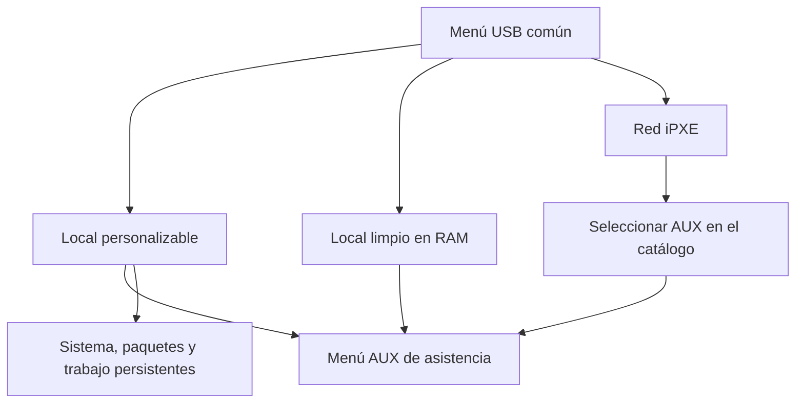

# Llave AUX combinada · kit 6.3.0-dev.1

Timestamp: 2026-10-17 | Version: 6.3.0-dev.1
Author & Credits: https://www.alawise.es/1-s

Kit experimental para preparar la próxima imagen USB: arranque local con
personalización, local limpio y red iPXE desde un mismo menú GRUB. El Live AUX
mantiene sus opciones de asistencia. El catálogo de otras distribuciones sigue
necesitando la red o sus imágenes locales adicionales.

Este paquete contiene el constructor, el código del menú y el ayudante del Live.
No incluye una imagen combinada construida ni una ISO compilada. No se ejecutó
el constructor completo: la ISO AUX compilada está fuera de este entorno y aquí
no hay dispositivos loop habilitados. No declarar esta entrega estable.

## Diseño



La imagen usa GPT, 1 MiB BIOS, 64 MiB EFI y ext4 con el resto. La base comprimida
del Live se almacena una sola vez; los perfiles local limpio y personalizable
comparten ese contenido mediante un enlace físico. Se despliegan los componentes
de la ISO para arrancar sin red. `--keep-iso` guarda además el archivo .iso original
y requiere espacio adicional.

El modo personalizable usa OverlayFS persistente, /work y /storage en el USB.
El modo limpio conserva el comportamiento en RAM de la ISO original. El menú
selecciona qué perfil usar; no se montan discos de clientes por etiqueta.
Las sesiones tmux viven en /run; el permiso reanudable y su clave de host se guardan de forma privada en el USB.

El perfil personalizable figura primero y GRUB lo selecciona automáticamente tras
5 segundos, por su identificador estable `aux-persistent`. Publicar un kernel nuevo
conserva ese identificador; elegir red o modo limpio una vez no cambia el siguiente
arranque predeterminado. El firmware del equipo debe tener prioridad de arranque USB.

La reanudación del caso web y C tras reiniciar está implementada en las fuentes.
El permiso inicial de ocho horas queda ligado al mismo equipo y técnico; el Live
lo restaura al arrancar sin repetir la autorización mientras siga vigente. La
pasarela mantiene el caso y TEC puede reconectar una terminal abierta. Se inicia
una shell nueva. El alcance, cierre, identidad y pruebas están en [RESUME.md](RESUME.md).
La aceptación en una ISO real con SELinux y hardware todavía está pendiente.

Es posible preparar las claves API de GPT y Gemini en la llave antes de empezar.
La ruta y el procedimiento están en [API-KEYS.md](API-KEYS.md). G/M permiten elegir
la clave preparada o introducir una manualmente; K permite sustituirla o borrarla.
El kit incorpora el parche público del lector y los controles locales al overlay
personalizable. No incluye claves reales. La carga no inicia consultas por sí sola.

La actualización del kernel requiere generar un initramfs Live genérico y publicar
kernel/initramfs en el medio de arranque; instalar el RPM por sí solo no realiza
esa publicación. Referencias primarias:

- https://fedoraproject.org/wiki/LiveOS_image#Kernel_updates_for_images_with_a_persistent_overlay
- https://dracut-ng.github.io/dracut.html#_booting_live_images

## Construir en Bebe

Usar Fedora 44 x86_64 con la ISO AUX 6.3 compilada y verificada. Conservar también
el cargador de 11 MB ya distribuido y su SHA-256. La ruta del constructor es build.py
en este kit; no confundirla con build.py de la raíz AUX/PXE.

```bash
sudo dnf install python3 xorriso util-linux gdisk dosfstools e2fsprogs \
  systemd-udev grub2-tools-extra grub2-pc-modules grub2-efi-x64-modules \
  policycoreutils zstd
python3 test_portable.py
```

Obtener la capacidad REAL, en bytes, del USB elegido mediante `lsblk -b`.
La imagen creada debe caber en ese modelo; dos llaves comerciales de 32 GB pueden
tener capacidades distintas. El constructor exige ese número, múltiplo de 512,
y solo crea un ARCHIVO nuevo. No ofrece selección ni escritura de dispositivos.

Reemplazar los valores de ejemplo y comenzar por el plan:

```text
python3 build.py --iso /ruta/aux-assist.iso --sha256 SHA256_ISO_VERIFICADO \
  --output /ruta/nueva/aux-portable.img --capacity-bytes CAPACIDAD_REAL_EN_BYTES
```

Para construir el archivo, añadir los datos del cargador y --build:

```text
sudo python3 build.py --iso /ruta/aux-assist.iso --sha256 SHA256_ISO_VERIFICADO \
  --ipxe-image /ruta/aux-ipxe-usb.img --ipxe-sha256 SHA256_CARGADOR_VERIFICADO \
  --output /ruta/nueva/aux-portable.img --capacity-bytes CAPACIDAD_REAL_EN_BYTES --build
```

El cargador 6.3 de 11 075 584 bytes utilizado en el proyecto tiene SHA-256:
`42f376ec0267d583716b3e802b64b742bfb8be7da385c780a70f3eb6afeb5f80`.
Su fuente iPXE, commit y licencias siguen siendo las del paquete original.
Este kit no redistribuye sus binarios.

El constructor formatea únicamente particiones del loop que comprueba que está
respaldado por su archivo nuevo. Extrae los componentes, instala GRUB BIOS/UEFI,
etiqueta los archivos del overlay con la política SELinux Fedora y genera
manifest.json, SHA-256 y el espacio libre inicial medido. Un error conserva .partial
para revisar y no publica el nombre final. No se anuncia Secure Boot.

La imagen raw tiene la capacidad solicitada; puede comprimirse después con zstd.
Antes de copiarla a un USB, comprobar capacidad y SHA. La grabación física debe
hacerse con la herramienta ya elegida, identificando modelo/serie y destino.
Este kit no incluye todavía un expansor para clonar a capacidades diferentes ni
individualización de UUID entre clones: usar una sola copia de la plantilla
conectada durante las pruebas. La imagen pública y su método de expansión quedan
pendientes de la aceptación con hardware.

## Personalizar y actualizar

Arrancar «local personalizable». La misma aplicación AUX conserva G/M/T/W/E.
Desde T, o desde la terminal humana previamente autorizada:

```bash
python3 /usr/share/aux-assist/portable_usb.py status
dnf install PAQUETE
```

Los paquetes y cambios del sistema permanecen en la raíz del USB. /work y
/storage también persisten en este perfil. Para actualizar el sistema y publicar
el kernel más recientemente instalado:

```bash
python3 /usr/share/aux-assist/portable_usb.py update
python3 /usr/share/aux-assist/portable_usb.py update --apply
```

El primer comando muestra el plan. El segundo verifica el medio, ejecuta DNF
interactivamente, construye initramfs y publica una entrada de arranque. No reinicia
automáticamente. Después del reinicio verificar `uname -r` y los paquetes añadidos.
Si el kernel ya se instaló mediante DNF por separado, publicar explícitamente:

```text
python3 /usr/share/aux-assist/portable_usb.py sync-kernel --kver VERSION_INSTALADA --apply
```

La publicación conserva el kernel anterior si siguen instalados sus módulos y
mantiene siempre la entrada local limpia con la base original. Esto recupera un
entorno de rescate; no promete deshacer todos los cambios de paquetes o datos.
Los kernels anteriores no se eliminan automáticamente del área AUX/boot en el kit.

## Espacio y aceptación

32 GB comerciales equivalen aproximadamente a 29,8 GiB. El espacio inicial libre
se mide después de construir: depende de la base, EFI, metadatos y si se conserva
también el archivo ISO. Los paquetes, kernels y datos añadidos comparten ese espacio.
No se reserva una partición fija de 6 u 8 GiB para el sistema.

Pruebas locales ejecutadas: diez pruebas del kit sobre contratos, checksum, guardas
de loop, identidad del medio, publicación atómica y preparación privada de claves
con fixtures. Las pruebas de permisos de propietario requieren root.
El kernel y el initramfs de esas pruebas son fixtures, no artefactos arrancables.
Los menús se validan además con grub-script-check cuando está disponible.

Antes de release: construir la imagen real; arrancar BIOS y UEFI en VM y en USB;
probar SELinux enforcing, red y modo sin conexión; instalar LightDM u otro paquete
y reiniciar; actualizar kernel y verificar uname -r; probar rechazo de medio ajeno,
fallo de actualización y arranque limpio. No publicar las pruebas de versiones
anteriores como aceptación de esta persistencia nueva. Completar además las pruebas
de reanudación de RESUME.md; el manifiesto distingue código implementado de aceptación Live pendiente.
Probar también la entrega real de credenciales a G/M, las opciones K/I y los
permisos SELinux de la llave. La integración de claves se verificó con fixtures,
sin una API facturable ni una máquina arrancada con esta imagen.
