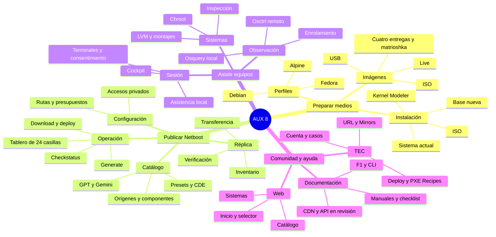
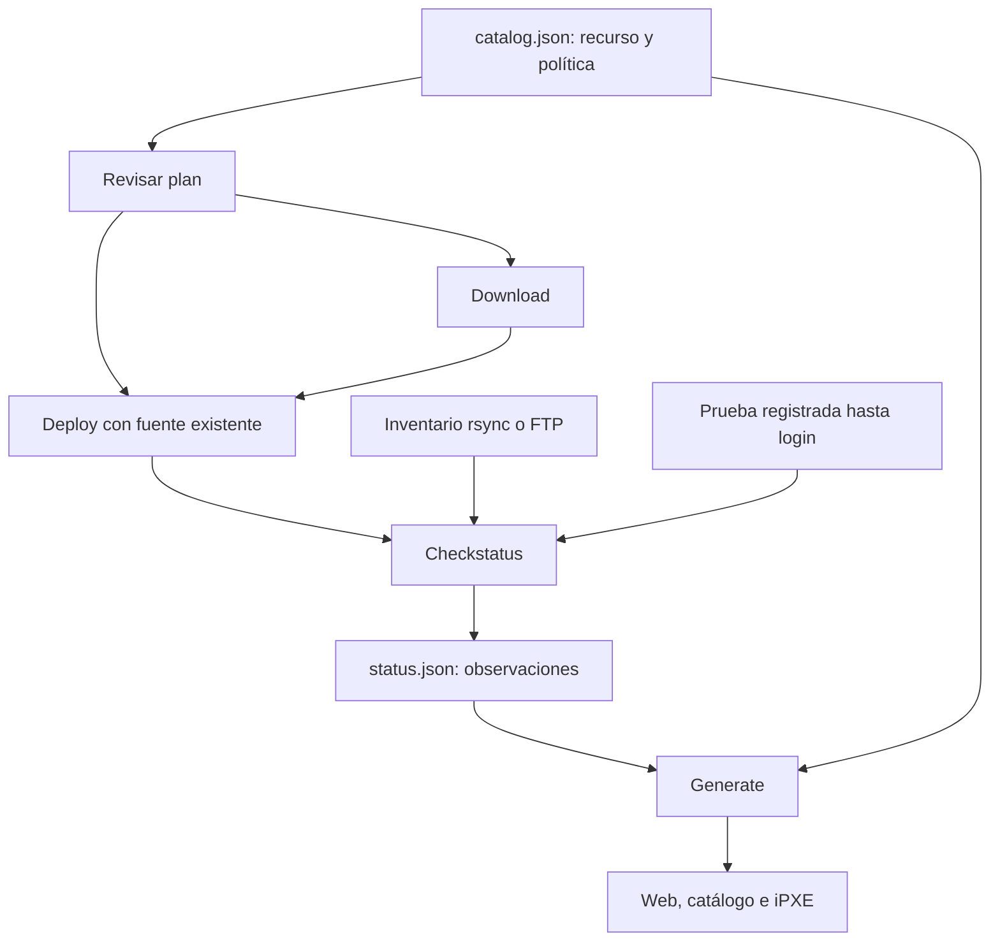

# Navegación de AUX 8

Timestamp: 2026-11-27 | Version: 8.0.1-beta.7  
Author & Credits: https://www.alawise.es/1-s

El menú conserva su posición al volver de una aplicación. F1 abre ayuda y vuelve
al mismo campo. La configuración usa índigo; la ejecución y los medios usan cian.
Esc permite cancelar el diálogo actual. La consola serie conserva alternativas
de texto cuando no hay interfaz de pantalla completa disponible.

## Mapa mental del conjunto

## Rutas exactas desde el menú principal

| Área | Entrada | Aplicación independiente | Opciones y resultado |
| --- | --- | --- | --- |
| ISO | Imágenes, perfiles y medios | `aux-images` | Planes de Live/ISO/USB y perfiles; construcción explícita. |
| ISO | Kernel Modeler | `aux kernel-modeler` | Banco de trabajo de núcleos: ISO, raíz nueva o sistema actual explícito. |
| Asistencia | Observación local/flota | `aux-observe` | Estado, tablas locales, entornos, nodos, consultas/resultados y preparación de enrolamiento. |
| Asistencia | Sistemas y chroot | `aux-enter` | Detectar dispositivos, inspección, montajes, LVM y reparación. |
| Asistencia | Controles locales VT6 | `aux-assist` | Sesión local y asistencia consentida. |
| Asistencia / herramientas | Cockpit | `aux-tools --tool cockpit` | Dirección y servicio del equipo. |
| Asistencia / herramientas | Área web local | `aux-tools --gui` | Acceso local al área de trabajo. |
| Despliegue | Settings | `aux-config` | Rutas, destinos, parámetros de IA, accesos y diagnóstico. |
| Despliegue | Catálogo | `aux-catalog` | Mostrar, validar, importar/migrar, presets, CDE, resolver y asistencia IA. |
| Despliegue | Perfiles | `aux-profile` | Selección nativa y exportación de perfiles de software. |
| Despliegue | Réplica íntegra | `aux-release` | Inventario, revisión, transferencia, verificación y publicación por fases. |
| Despliegue | Estado e inventario | `aux-checkstatus` | Estado local/remoto, hash opcional, consulta y registro de prueba hasta login. |
| Despliegue | Descargar | `download.sh` / `aux download` | Plan de adquisición y descarga a caché. |
| Despliegue | Desplegar | `deploy.sh` / `aux deploy` | Destinos de la política: RAM, disco y Bastion. |
| Despliegue | Generar | `generate.sh` / `aux generate` | Publicar desde una instantánea vigente. |
| Sistema actual al final | Instalar y personalizar | `aux-setup` | ISO, raíz nueva o modificación explícita del sistema actual. |

## Catálogo y observación

## Entradas web e iPXE

| Página o menú | Acceso y función |
| --- | --- |
| `index.html` / `index.php` | Portal gráfico y catálogo publicado. |
| `index-pxe.html`, `cli.html`, `cli-all.html` | Navegación terminal/Links. |
| `workspace.html` | Entrada a instalar, catálogo, sistemas y TEC. |
| `installer.html` | Distribución, destino, tareas/grupos nativos y herramientas AUX. |
| `catalogue.html` | Presets acumulables, búsqueda, políticas, origen y exportación JSON. |
| `systems.html` | Comandos para entrada guiada al sistema y Cockpit. |
| `contents.html` y páginas de recurso | Archivos y árboles de los medios realmente disponibles. |
| `menu.ipxe` | Jerarquía de arranque, proveedores y recetas preparadas. |
| `components.ipxe` | Recetas aprobadas por componentes, con procedencia visible. |
| `tec.1-s.es` | Cuenta, casos, cliente/USB, consola autorizada y foros. |
| `forum.php?board=urls` | URL & Mirrors. |
| `forum.php?board=deploy` | Deploy / 12 bits: propuestas de política. |
| `forum.php?board=pxe` | PXE Recipes: procedimientos y recetas moderadas. |

## Rescue Live en dialog

El selector ofrece instalación, catálogo, sistemas/chroot, Cockpit, carga de
técnicos, asistencia SSH/web, terminal local, configuración de red y control de
apagado. GPT/Gemini y sus claves aparecen cuando esa capacidad está habilitada.
Las acciones conservan sus confirmaciones y su consentimiento. Un Esc vuelve al
selector y la ayuda explica el alcance; el menú no acredita pruebas de hardware.

El tablero común de Estado/Catálogo está en web y en `aux catalog board`. La guía Blue Hibou / Red Robin está en precautions.html y docs/RED-ROBIN-8.md.
